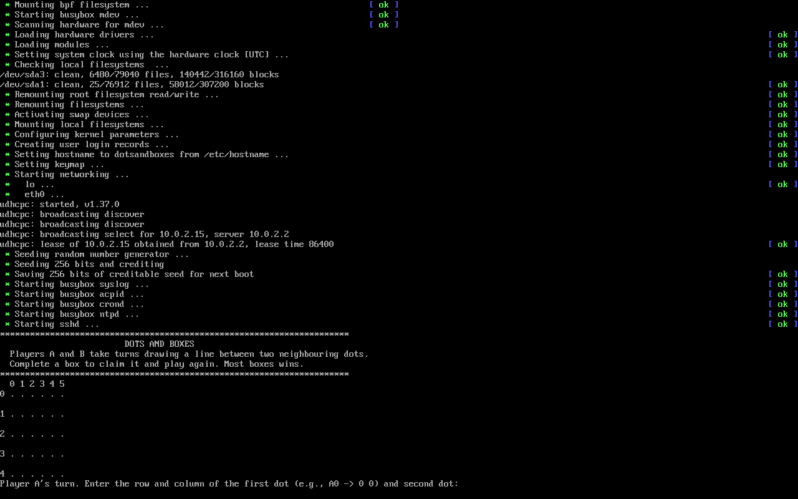
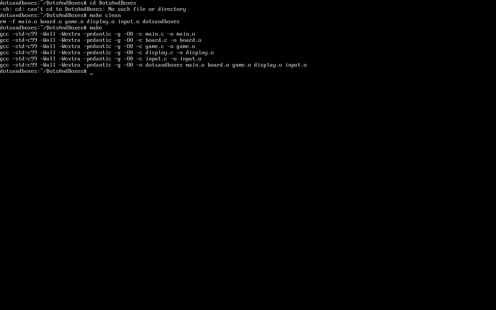
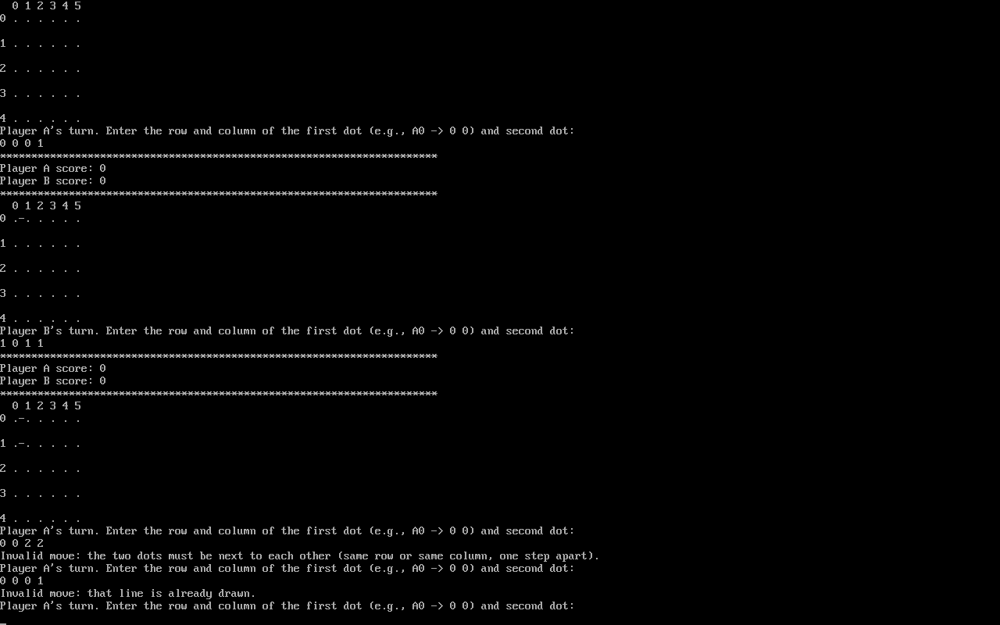
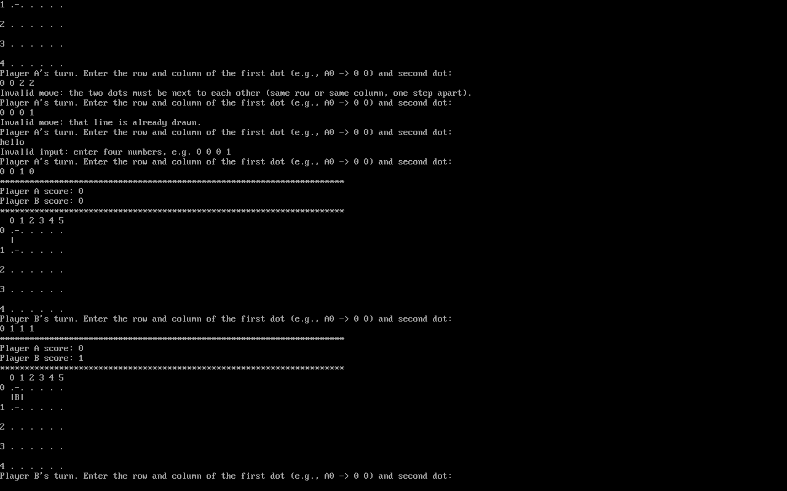
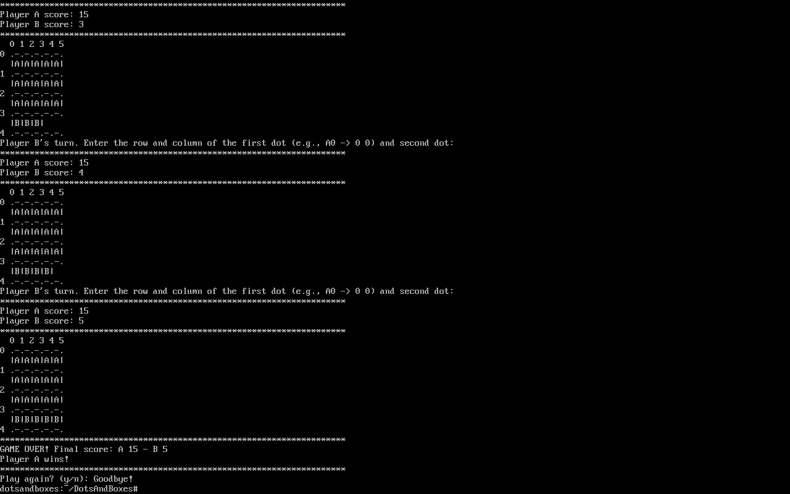
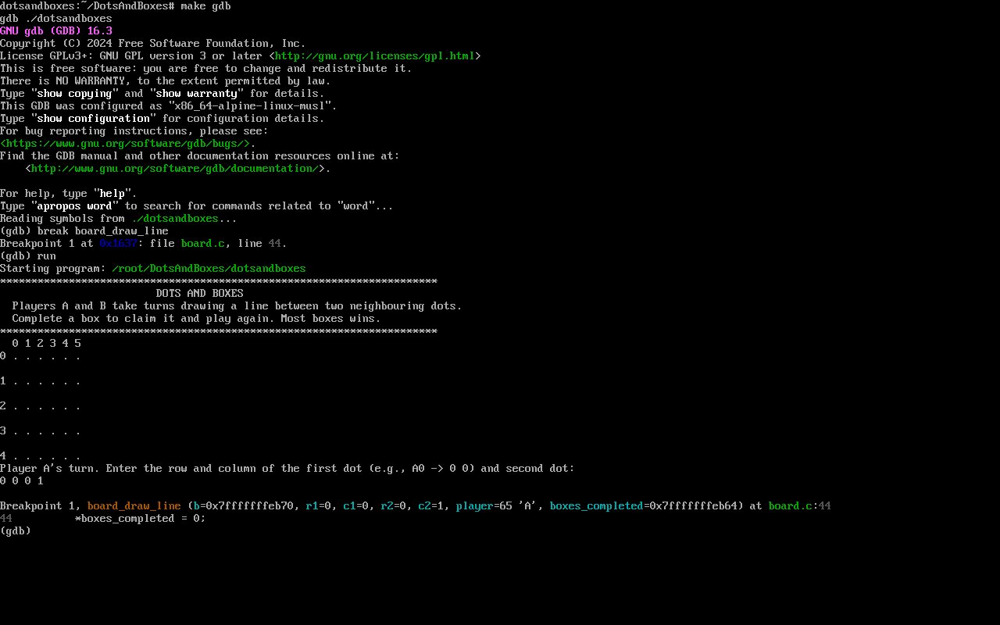
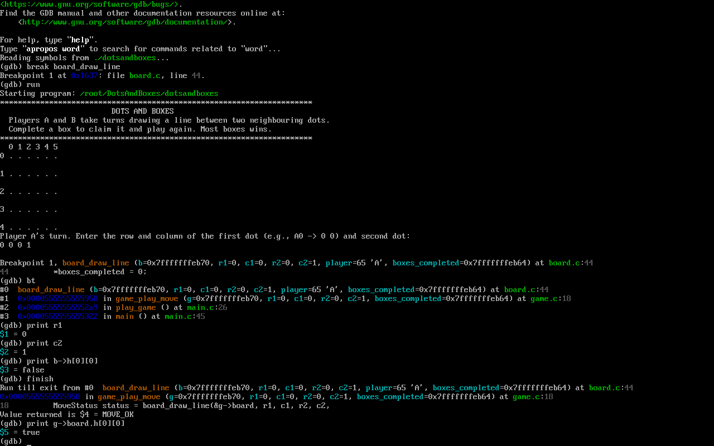
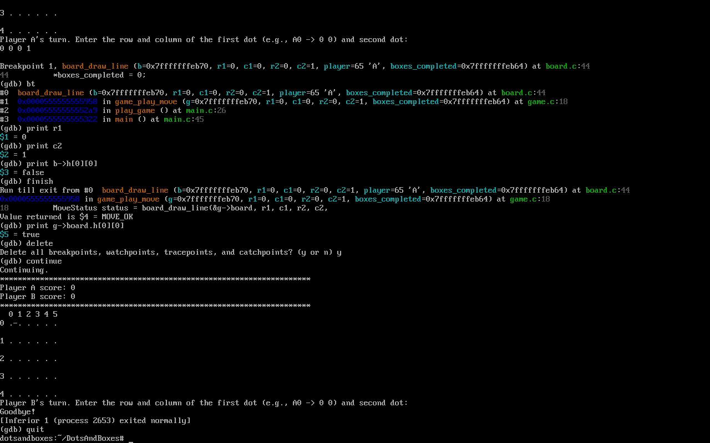
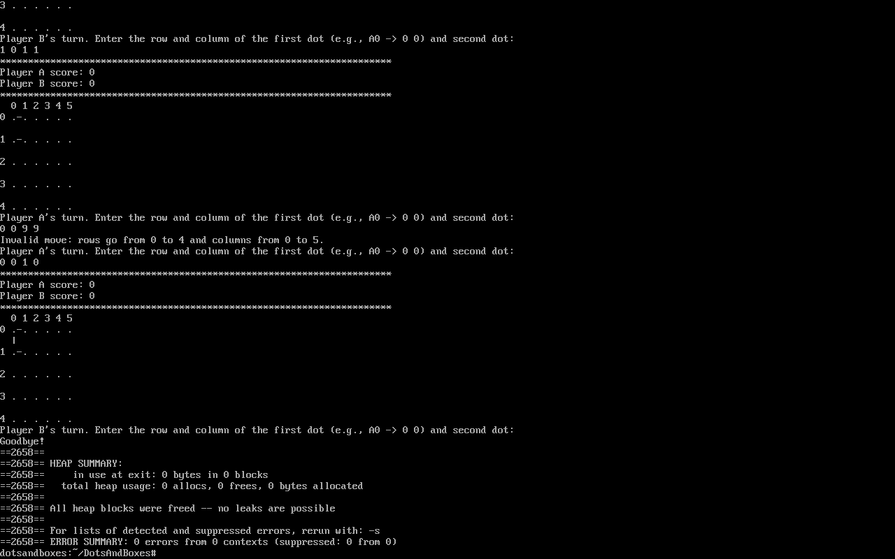
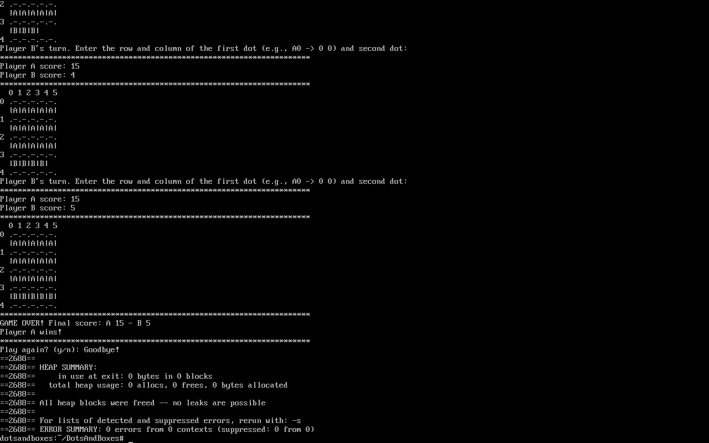

# Sprint 1: Testing and Debugging

This document covers how the Sprint 1 game was built, tested and debugged on Alpine Linux,
with screenshots taken inside the VirtualBox VM.

## 1. Environment

| Item | Value |
|---|---|
| OS | Alpine Linux 3.24.4 (x86_64, `virt` image), no GUI |
| VM | VirtualBox, 512 MB RAM, 1 CPU, 2 GB disk |
| Compiler | `gcc` with `-std=c99 -Wall -Wextra -pedantic -g -O0` |
| Debuggers | GDB 16.3, Valgrind |
| Tools installed with | `apk add build-base gdb valgrind git` |

`-g -O0` keeps full debug symbols and disables optimisation, so GDB shows real variable values
and steps through the source line by line.

## 2. Starting the game at boot (no login)

Alpine uses BusyBox `init`, configured by `/etc/inittab`. By default, the first console runs a
login prompt:

```
tty1::respawn:/sbin/getty 38400 tty1
```

We installed the game and replaced that line so the console runs the game instead:

```sh
make install                      # copies the binary to /usr/local/bin/dotsandboxes
cp /etc/inittab /etc/inittab.bak  # backup
sed -i 's#^tty1::respawn:.*#tty1::respawn:/usr/local/bin/dotsandboxes#' /etc/inittab
reboot
```

- `tty1` is the screen shown when the VM starts, so the game appears directly after boot.
- `respawn` restarts the game whenever it exits, so the VM always shows the game.
- A normal login is still available on the second console (**Alt + F2**) for maintenance.



## 3. Build

A clean build produces no warnings or errors, even with `-Wall -Wextra -pedantic`.



## 4. Functional tests

| # | Input | Expected | Result |
|---|---|---|---|
| 1 | `0 0 0 1` | Line drawn, turn passes to B | ✅ |
| 2 | `0 0 2 2` | Rejected: dots are not neighbours | ✅ |
| 3 | `0 0 0 1` again | Rejected: line already drawn | ✅ |
| 4 | `hello` | Rejected: must be four numbers | ✅ |
| 5 | `0 0 9 9` | Rejected: dot outside the grid | ✅ |
| 6 | Last side of a box | Box shows the player's letter, score +1, same player plays again | ✅ |
| 7 | Full game ([tests/full_game.txt](tests/full_game.txt)) | All 20 boxes claimed, winner declared | ✅ A 15 – B 5, "Player A wins!" |

After an invalid move the player keeps their turn and the board is unchanged.





The full game is replayed from a file, so it can be repeated exactly:

```sh
./dotsandboxes < tests/full_game.txt
```



## 5. Debugging with GDB

**Goal:** confirm that a move travels correctly from input to the board, and that the board is
only changed by `board_draw_line`.

```
make gdb
(gdb) break board_draw_line      # stop whenever a line is drawn
(gdb) run                         # then type the move: 0 0 0 1
(gdb) bt                          # call stack: main -> play_game -> game_play_move -> board_draw_line
(gdb) print r1                    # 0, the parsed input reached the function correctly
(gdb) print c2                    # 1
(gdb) print b->h[0][0]            # false, the line is not drawn yet
(gdb) finish                      # run to the end of the function
                                  # Value returned is MOVE_OK
(gdb) print g->board.h[0][0]      # true, the line is now drawn
(gdb) delete
(gdb) continue
```

**What this shows:**
- The breakpoint arguments (`r1=0, c1=0, r2=0, c2=1, player='A'`) prove that input parsing in
  `input.c` and turn handling in `game.c` pass the right values.
- The backtrace confirms the intended module structure:
  `main.c` → `game.c` → `board.c`.
- Inspecting `h[0][0]` before and after `finish` proves that the line from dot (0,0) to (0,1) is
  stored in the horizontal-line array at the expected index.







## 6. Memory checking with Valgrind

**Goal:** make sure there are no invalid reads/writes (for example, out-of-bounds array
accesses), no uses of uninitialised values, and no memory leaks.

```sh
make valgrind                                         # interactive game
valgrind --leak-check=full ./dotsandboxes < tests/full_game.txt   # full game
```

The full-game run goes through every part of the program (all line types, box claiming,
extra turns, end of game, winner, the "play again" prompt), so it is the strongest check.

**Result for both runs:**

```
All heap blocks were freed -- no leaks are possible
ERROR SUMMARY: 0 errors from 0 contexts
```

The program makes **0 heap allocations**: the board is a fixed-size struct on the stack, and
input is read into a fixed buffer with `fgets`. This design rules out leaks and
`fgets` (not `scanf`/`gets`) rules out input buffer overflows.





## 7. Defensive design choices

| Risk | How the code handles it |
|---|---|
| Dot outside the grid | `dot_in_range` is checked before any array access |
| Out-of-bounds box index (edge lines) | `try_claim` checks the box exists before reading it |
| Non-numeric or long input | Whole line read with `fgets`, then `sscanf` must find exactly 4 integers; overlong lines are discarded |
| End of input (Ctrl+D, or the input file ends) | Detected and the program exits cleanly instead of looping |
| Redrawing an existing line | Rejected, board unchanged, same player plays again |

## 8. Complexity

- **Checking if a move completes a box:** **O(1)**. A line borders at most two boxes, and each
  box is checked by reading its four sides.
- **Drawing a line / validating a move:** O(1).
- **Printing the board:** O(R × C), where R × C is the number of dots.
- **End-of-game check:** O(1). The two scores are compared with the total number of boxes
  (20), instead of scanning the board.
